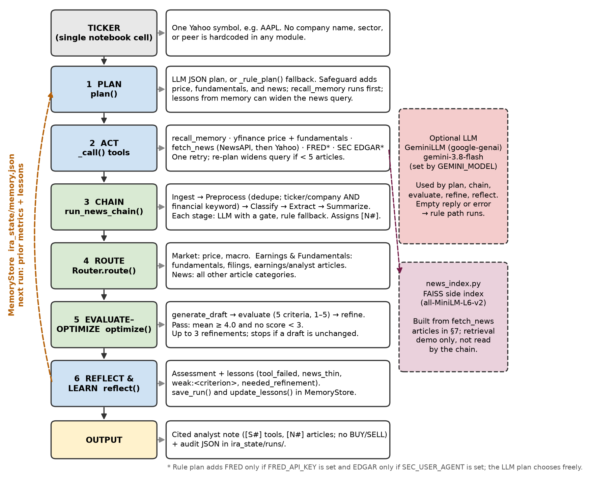

# AAI 520 — Investment Research Agent

Autonomous multi-agent system that takes one equity ticker and produces a cited analyst note.
Built for the USD MS Applied AI final team project (AAI 520, Team 2).

**GitHub:** https://github.com/dshrestha37/investment-research-agent

## Team roles

- **Deepika Shrestha** — Agent core: plan, tools, prompt chain, router, evaluator–optimizer, memory.
- **Christian Lopez** — News ingestion: Yahoo headlines, category tagging, FAISS side index.
- **Cameron Aljilani** — Integration of both notebooks, bug fixes, news relevance filters, evidence and visualization cells, Colab wrapper, and executed runs.

## What the agent does

1. **Plans** research steps for a given ticker.
2. **Uses tools** dynamically (Yahoo Finance prices/fundamentals, NewsAPI or Yahoo news, FRED macro, SEC EDGAR, memory recall).
3. **Self-reflects** on the quality of the note (5-criterion evaluator: grounding, completeness, balance, transparency, memory use).
4. **Learns across runs** (JSON memory of prior metrics and lessons).

**Workflow patterns**
- Prompt chaining: ingest → preprocess → classify → extract → summarize (news).
- Routing: articles and tool results directed to market, earnings, or news specialists.
- Evaluator–optimizer: draft → score → refine (up to 3 rounds).

The notebook also prints the trace behind each function and workflow (section 6b) and plots three charts (section 6c): price with 20/50-day averages, evaluator scores per draft, and articles routed per specialist.

## Architecture Diagram


## How to run

1. Upload `AAI520_Final_Project_Team_2_Aljilani_Lopez_Shrestha.ipynb` to Google Colab.
2. Add secrets (Colab sidebar, key icon):
   - `GEMINI_API_KEY` (LLM mode; the rule fallback still writes a note without it)
   - `NEWSAPI_KEY` (optional; otherwise Yahoo headlines)
   - `FRED_API_KEY` (optional macro)
   - `SEC_USER_AGENT` (contact string for EDGAR, e.g. `AAI520-IRA you@sandiego.edu`)
3. Runtime → Restart session and run all. The run cell clears `ira_state/` first (`FRESH_START = True`) so Run 1 is a true first run.
4. The ticker is set in one cell only (`TICKER = "AAPL"`). Change it and re-run; nothing else is hardcoded.
5. Download the executed notebook and export PDF or HTML for Canvas submission.

A CPU runtime is enough (no GPU needed).

The notebook writes every module with `%%writefile` (`schema.py`, `market_tools.py`, `news_tools.py`, `extra_tools.py`, `llm.py`, `memory.py`, `chain.py`, `router.py`, `evaluator.py`, `research_agent.py`, `news_index.py`, `test_pipeline.py`). Each module docstring is its change log. Offline tests (`python test_pipeline.py`, 10 tests) run in section 4 with no keys or network.

## Repository layout

```
├── AAI520_Final_Project_Team_2_Aljilani_Lopez_Shrestha.ipynb      # submission notebook (executed)
├── Investment_Research_Agent_Deepika_Shrestha_09_29_2026_Github_Upload.ipynb   # original agent notebook
├── News_Ingestion_Pipeline.ipynb                                   # original news notebook
└── README.md
```

## Key fixes and improvements

- Router phrase bug fixed ("trading between of its averages" → complete phrases).
- "No news retrieved" no longer appears in the Summary when every article was routed to the Earnings specialist.
- Claude model id corrected; Gemini is the path used.
- Empty news returns `ToolResult.failure` (synthetic fallback article removed).
- News relevance filters added (generic financial keywords; works for any ticker).
- Gemini-mode fixes: the evaluator accepts heading variants, combined citations (`[S2, S3]`) count, truncated replies are flagged, lessons are de-duplicated, and the writer is told the prior run id.
- An LLM status line after each run shows the model, call count, and any error, so a silent fallback to rules is visible.
- Memory path is `ira_state/memory.json`; the second run names Run 1's id under "Changes since last run" and uses Run 1's lessons.
- Citations are only `[S#]` and `[N#]`. No BUY/SELL line.

## Final run (Oct 18, 2026)

AAPL, Gemini `gemini-3.8-flash`, 14 LLM calls with no errors. 10/10 offline tests pass. Both runs planned 6 steps and kept 6 of 12 NewsAPI articles; both first drafts passed the evaluator at 5.0/5, so no refinement was needed (an earlier run refined Run 2 from 4.4 to 5.0). FAISS indexed 20 chunks.

`ira_state/` (memory and audit logs) is runtime output and is not committed.

## Code style

PEP 8 checked with flake8. Blank-line, unused-variable, import, and ambiguous-name issues in the integration code are fixed. Some long lines remain in the original teammate modules.

## AI disclosure

- **Google Gemini `gemini-3.8-flash`** (`google-genai`) is an optional runtime component (planning, news classify/extract/summarize, drafting, judging, refining), with rule-based fallbacks for every step.
- **Grok (xAI)** for integration, debugging, and documentation formatting.

All agent logic, tool contracts, workflow patterns, and final notebook content were reviewed, tested, modified, and executed by the team. Outputs are grounded in fetched data; no citations or metrics are invented.

## Requirements

Python 3.10+, packages listed in the notebook install cell (`yfinance`, `google-genai`, `langchain-*`, `sentence-transformers`, `faiss-cpu`, etc.). Colab is the intended runtime.
